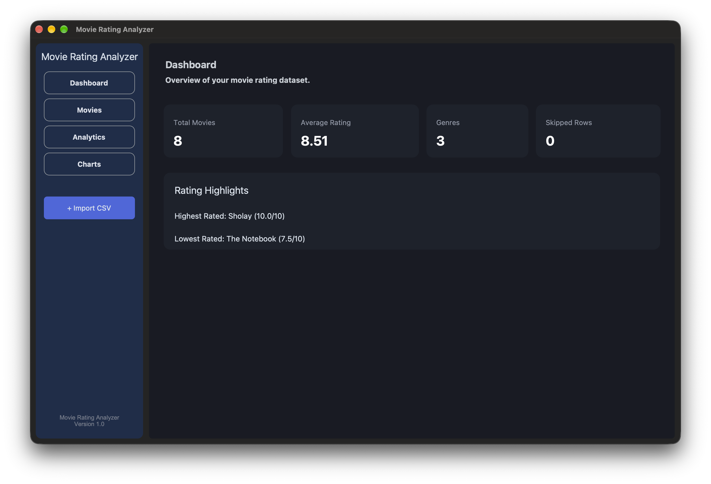
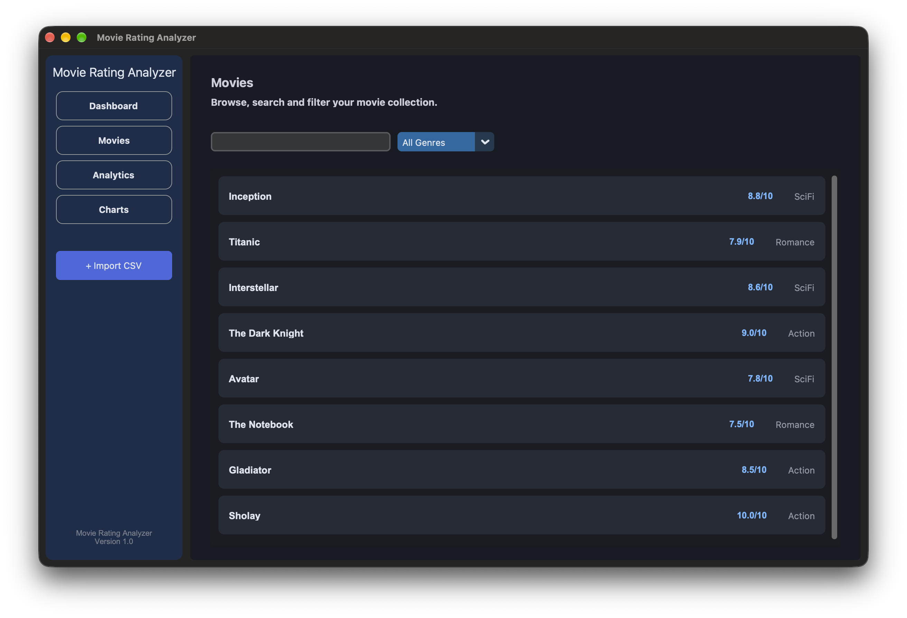
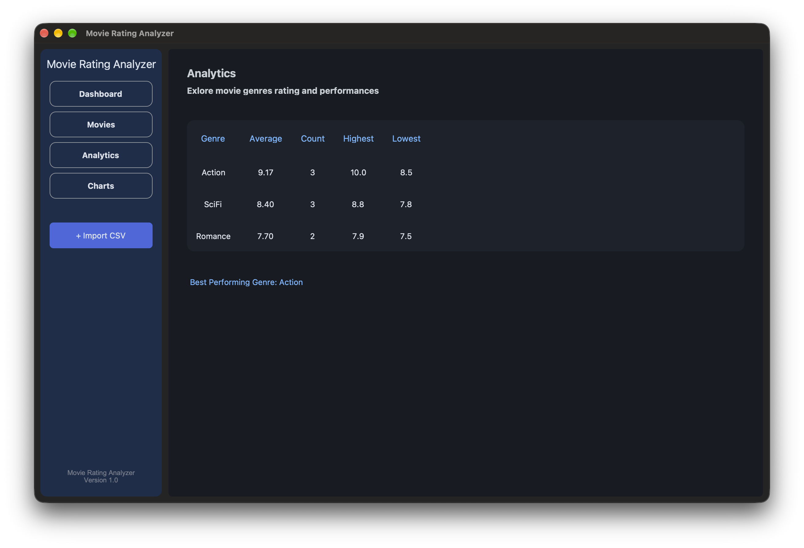
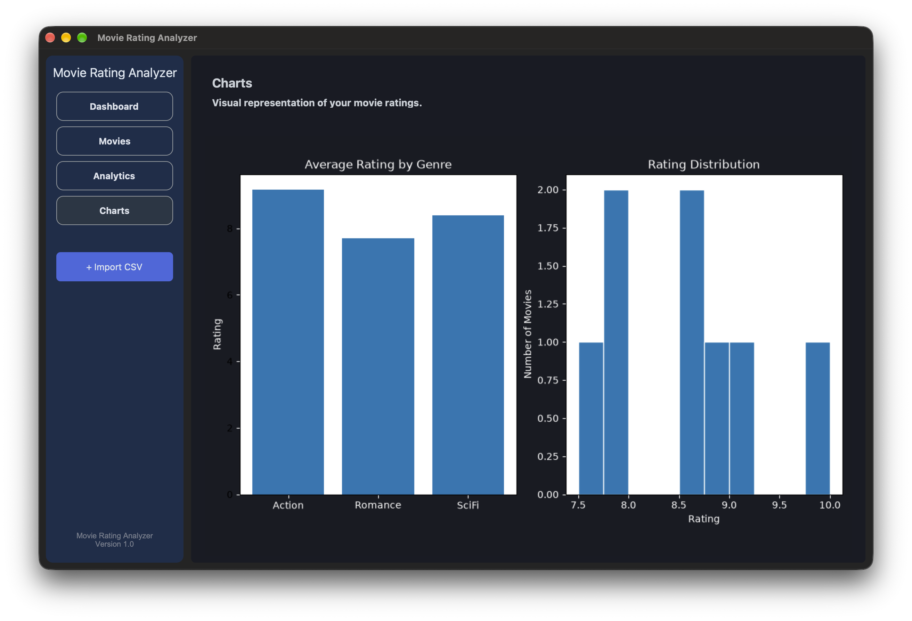

# 🎬 Movie Rating Analyzer

## Student Information
- Name: Rishaw Kumar
- Section: J
- Roll No: RU-26-02282

A Python desktop application for analyzing movie ratings, exploring genre-wise performance, cleaning movie datasets, and visualizing rating distributions.

Built using **Python, CustomTkinter, Pandas, and Matplotlib**, this application provides an interactive interface for understanding movie rating data.

## ✨ Features

### 1. Dashboard
- Total number of movies.
- Overall average rating.
- Number of unique genres.
- Number of skipped records.
- Highest-rated movie.
- Lowest-rated movie.

### 2. Movies
- Display all imported movies.
- Search movies by title.
- Filter movies by genre.
- View movie ratings and genres.

### 3. Analytics
- Genre-wise average rating.
- Number of movies in each genre.
- Highest rating in each genre.
- Lowest rating in each genre.
- Identify the best-performing genre.

### 4. Charts
- Bar chart showing average ratings by genre.
- Histogram showing movie rating distribution.

### 5. CSV Import and Data Cleaning
- Import movie datasets using CSV files.
- Validate required columns.
- Handle missing and empty values.
- Reject non-numeric ratings.
- Reject ratings outside the 0–10 range.
- Detect and skip duplicate records.
- Track skipped records and their reasons.

## 🛠️ Technologies Used

| Technology | Purpose |
|---|---|
| Python | Core programming language |
| CustomTkinter | Desktop graphical interface |
| Pandas | CSV processing and data analysis |
| Matplotlib | Data visualization |
| Tkinter | File selection and message dialogs |

## 📁 Project Structure

```text
Movie-Rating-Analyzer/
│
├── main.py                  # Main application source code
├── README.md                # Project overview and setup instructions
├── Summary.md               # Project summary, challenges, and test cases
├── requirements.txt         # Required Python libraries
├── .gitignore               # Files and folders ignored by Git
├── LICENSE                  # MIT LICENSE
├── .python-version          # Python Version used in Project
│
├── data/
│   └── sample_movies.csv    # Sample movie dataset used for testing
|   ├── movies.csv           # Another movie dataset used for testing
│
└── Screenshots/
    ├── Analytics-SS.png     # Genre-wise analytics
    ├── Charts-SS.png        # Data visualization
    ├── Dashboard-SS.png     # Dashboard interface(when CSV not imported)
    ├── Dashboard-CSV-SS.png # Dashboard Interface(when CSV is imported)
    ├── Import-CSV.png       # Importing CSV in App
    ├── Movies-SS.png        # Movies listing section
```

`.venv/` is your local virtual environment and should not be committed to GitHub.

## ⚙️ Installation and Setup

### Prerequisites

- Python 3.10 or newer
- Git
- pip

### 1. Clone the repository

```bash
git clone https://github.com/the-rishaw/Movie-Rating-Analyzer.git
```

### 2. Navigate to the project directory

```bash
cd Movie-Rating-Analyzer
```

### 3. Create a virtual environment

```bash
python -m venv .venv
```

### 4. Activate the virtual environment

**macOS / Linux**

```bash
source .venv/bin/activate
```

**Windows**

```bash
.venv\Scripts\activate
```

### 5. Install dependencies

```bash
pip install -r requirements.txt
```

### 6. Run the application

```bash
python main.py
```

## 📄 CSV Dataset Format

The application expects a CSV file containing these three required columns:

| Column | Description |
|---|---|
| Movie | Name of the movie |
| Genre | Movie genre |
| Rating | Movie rating between 0 and 10 |

### Sample Dataset

```csv
Movie,Genre,Rating
Inception,SciFi,8.8
Titanic,Romance,7.9
Interstellar,SciFi,8.6
The Dark Knight,Action,9.0
Avatar,SciFi,7.8
The Notebook,Romance,7.5
Gladiator,Action,8.5
Sholay,Action,10
Sholay,Action,10
Ironman,Action, abc
The Batman,Action,11
Batman Begins,Acton,
Action,9
Batman Begins,,9
Batman Begins,Action,-2
```

## 🧹 Data Cleaning Rules

The application validates the imported dataset before performing analysis.

| Condition | Action |
|---|---|
| Missing values | Skip record |
| Empty movie or genre | Skip record |
| Non-numeric rating | Skip record |
| Rating below 0 | Skip record |
| Rating above 10 | Skip record |
| Duplicate record | Skip record |

Only valid records are included in the analysis.

## 🏗️ Application Architecture

The project follows an object-oriented programming approach with two primary classes.

### MovieDataManager

Responsible for:
- Loading CSV datasets.
- Cleaning and validating data.
- Managing movie records.
- Calculating overall statistics.
- Generating genre-wise statistics.

### MovieRatingAnalyzer

Responsible for:
- Creating the desktop application.
- Managing sidebar navigation.
- Displaying the dashboard.
- Rendering the movie collection.
- Displaying genre analytics.
- Integrating Matplotlib charts.

## 🎯 Project Objectives

- Practice Python object-oriented programming.
- Understand data manipulation using Pandas.
- Perform statistical analysis on real-world datasets.
- Learn data visualization using Matplotlib.
- Develop a functional desktop application using CustomTkinter.
- Implement CSV handling and data validation.

## 🚀 Future Improvements

- Movie poster integration.
- Advanced movie filtering and sorting.
- More statistical visualizations.
- Improved dashboard customization.
- Support for larger movie datasets.

## 📸 Application Screenshots

### Dashboard


### Movies


### Analytics


### Charts


## 👨‍💻 Author

**Rishaw Kumar**

GitHub: [@the-rishaw](https://github.com/the-rishaw)

---

*Built as a Python project to explore data analysis, visualization, and object-oriented programming.*